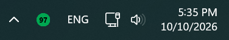
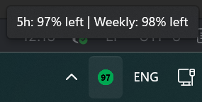
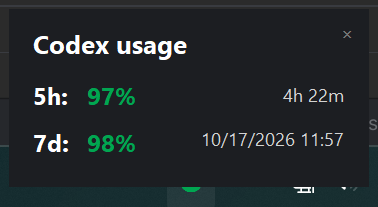
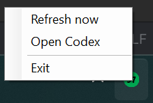

# WindowsCodexUsageTaskbar

> **Disclaimer:** This project is fully vibe coded.

A lightweight Windows notification-area app that shows your Codex usage percentage and reset time at a glance.

The app displays a colored tray icon and tooltip, and opens a compact usage panel when the icon is clicked. Usage is shown in green, orange, or red depending on how much remains. On first launch, it can optionally add itself to Windows startup and create a desktop shortcut.

## Requirements

- Windows 10 or later
- .NET 8 SDK
- The official Codex app installed and signed in

## Build

From PowerShell, run either script. Both scripts automatically use their own project directory:

```powershell
.\build.ps1
```

The release build is created in `bin\Release\net8.0-windows\`.

To stop the app, remove generated build output, and perform a clean rebuild, run:

```powershell
.\clean-and-build.ps1
```

This removes only the generated `bin` and `obj` directories before rebuilding.

For a clean self-contained publish, run:

```powershell
.\clean-and-build.ps1 -Portable
```

To create a self-contained Windows executable, run:

```powershell
.\build.ps1 -Portable
```

The self-contained executable is placed under `bin\Release\net8.0-windows\win-x64\publish\`.

## Usage

Run `WindowsCodexUsageTaskbar.exe` from the release output folder. The app appears in the Windows notification area.

- Left-click the tray icon to show or hide the usage panel.
- Hover over the icon to see both usage percentages.
- Right-click for refresh, Open Codex, or Exit.
- On first launch, choose whether to start the app automatically with Windows and whether to create a desktop shortcut.
- The app refreshes usage once per minute.

The desktop shortcut points to the current executable and uses the application icon from `assets\icons\`.

Reset times are converted to your local time zone and displayed using your Windows regional date and time settings.

The app communicates with the local Codex app-server and does not read browser cookies, scrape ChatGPT, request an API key, or store credentials.

Only one instance runs at a time, so launching the executable again will not create a second tray icon.

The tray icon shows the remaining 5-hour usage limit. Its color reflects whichever limit has less remaining usage, so a low weekly limit is visible even when the 5-hour percentage is still high. The usage panel shows both the 5-hour and weekly limits, including the reset time for each window; the tray tooltip shows both remaining percentages.

## Customizing colors

All customizable colors are near the top of `Program.cs` in the `AppColors` class. Change the RGB values to customize the tray icon and usage panel:

```csharp
public static readonly Color Green = Color.FromArgb(0, 166, 81);
public static readonly Color Orange = Color.FromArgb(204, 106, 0);
public static readonly Color Red = Color.FromArgb(196, 30, 30);
public static readonly Color TrayText = Color.Black;
public static readonly Color PanelBackground = Color.FromArgb(28, 30, 34);
public static readonly Color PanelText = Color.White;
public static readonly Color PanelResetText = Color.LightGray;
public static readonly Color PanelCloseText = Color.Gray;
```

`Green`, `Orange`, and `Red` control the usage colors. `TrayText` controls the percentage text in the tray icon. The `Panel...` values control the usage panel background, labels, reset text, and close button.

After changing the colors, rebuild the project and restart the application.

Other behavior and layout settings are also near the top of `Program.cs`, in the `AppSettings` class:

```csharp
public const int RefreshIntervalSeconds = 60;
public const int OrangeThresholdPercent = 25;
public const int RedThresholdPercent = 10;
public const int PanelWidth = 360;
public const int PanelHeight = 178;
public const float PanelHeaderFontSize = 13;
public const float PanelUsageFontSize = 12;
public const float PanelResetFontSize = 9;
public const bool OpenPanelOnLeftClick = true;
public const bool ShowWeeklyLimit = true;
public const bool ColorIconByWeeklyLimit = true;
public const bool AskForStartupOnFirstRun = true;
public const bool AskForDesktopShortcutOnFirstRun = true;
```

These settings control, respectively, the refresh interval, orange/red remaining-usage thresholds, panel dimensions, panel font sizes, left-click behavior, weekly-limit visibility in the panel and tooltip, whether the icon color follows the weekly limit, and whether the two first-run prompts are enabled. Keep the refresh interval at `1` or higher. A shorter interval may make the app-server work harder, while a longer interval makes the displayed usage less current.

When `ColorIconByWeeklyLimit` is `true`, the icon uses the most urgent color from either limit: a 5-hour orange limit still produces an orange icon when the weekly limit is green, and the same applies to red. Set it to `false` to make the icon color follow only the 5-hour limit.

## Screenshots

Tray icon:



Hovering over the tray icon shows both usage percentages:



Usage panel after left-clicking the tray icon:



Context menu after right-clicking the tray icon:



## License

Personal project; no license has been specified yet.
